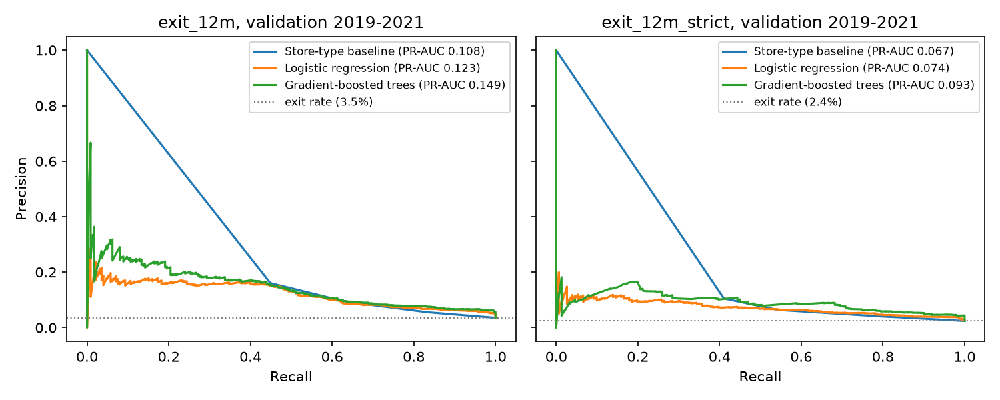

# D3. Model Evaluation: Predicting SNAP Grocery Exits in North Carolina

Nick Daniels, Feyruz Habteab, Eric Ho, Vishnu Inuganti, Hailey McCall, Jordan Sentosa

Repository (D3 snapshot): [https://github.com/jrdn-sentosa/snap-grocery-exits-nc/tree/d3](https://github.com/jrdn-sentosa/snap-grocery-exits-nc/tree/d3)

## Question and setup

Our research question asks whether, using only what is known on January 1, we can predict which SNAP grocery stores in North Carolina will lose their SNAP authorization in the next 12 months better than the historical exit rate for their store type. To answer it, we compared three approaches. The baseline gives every store the exit rate of its store type from the training years. The two candidates are a logistic regression and a gradient-boosted tree model. All three were fit on the same rows, the 2012–2018 training years (14,982 store-years, 632 exits), and scored on the same validation years, 2019–2021 (6,348 store-years, 225 exits). We start in 2012 because that is the first year with Census ACS data; starting any earlier would mean the models and the baseline were judged on different stores. The test years (2022–2024) were not touched.

Both models used the same 20 inputs, including store type, store age, chain size, counts of nearby stores, a store’s past authorization history, and tract measures from the ACS. Race and ethnicity were not inputs, and neither was the calendar year. We tuned each model with rolling folds inside the training years, training on 2012 up to a given year and scoring the next one, for 2015 through 2018. Missing values and scaling were fit on the training years only. We also converted tract income from dollars to a percentile within each year, since a dollar in 2012 does not mean the same thing as a dollar in 2021.

Exits are rare, about 3.5% of store-years. That is to say, a model that predicted “no exit” for every store would be right 96.5% of the time and completely useless. So we judged the models mainly by PR-AUC, and we looked at how many exits each one caught among the 50 highest-risk stores statewide each year and the top 10 in Mecklenburg, which is the outreach use our proposal described. Confidence intervals come from resampling stores 1,000 times.

## Results

| Model              | PR-AUC (95% CI) | ROC-AUC | Exits caught in top-50 lists, 2019–2021 total (of 225) | Mecklenburg exits caught in top-10 lists, 2019–2021 total (of 23) |
|------------------------|---------------------|-------------|------------------------------------------------------------|-----------------------------------------------------------------------|
| Store-type baseline    | 0.108 (0.088–0.130) | 0.752       | 22                                                         | 6                                                                     |
| Logistic regression    | 0.126 (0.101–0.160) | 0.800       | 29                                                         | 5                                                                     |
| Gradient-boosted trees | 0.132 (0.107–0.170) | 0.818       | 28                                                         | 7                                                                     |

*Precision-recall curves on the validation years (2019–2021), main label (left) and strict label (right).*

Both models beat the baseline. Logistic regression improved PR-AUC by somewhere between 0.006 and 0.043, and the trees by between 0.010 and 0.050; neither interval includes zero. In practical terms, the logistic regression’s top 50 lists caught 29 exits over three years where the baseline caught 22. So the answer to our research question is yes. It is also a small yes. When we used the stricter label that leaves out batch deauthorizations, neither model was clearly better than the baseline (logistic regression 0.074 vs. 0.067, with an interval from −0.004 to 0.031).

## Model selection

We chose logistic regression. The trees scored slightly higher on validation (0.132 vs. 0.126), but the difference between them ranged from −0.013 to 0.027; we can’t honestly tell the two apart. Logistic regression did better on the tuning folds (0.148 vs. 0.141) and on the strict label (0.074 vs. 0.068), where the trees did no better than the baseline. It is also the simpler model, and its coefficients can be explained to someone who isn’t a data scientist. The trade-off is real, though. The trees’ top 50 lists caught more of the exits that left no other SNAP grocery within a mile (10 vs. 4 of 44) and more Mecklenburg exits (7 vs. 5 of 23). These counts are small, but they’re worth checking again on the test years.

## Error analysis

First, it’s important to highlight that every store flagged by the baseline or by logistic regression was a small grocery, and the trees put 147 of their 150 flags on small groceries (the other three were not exits). None of the 124 exits from supermarkets, super stores, and large and medium groceries was caught by any model. Essentially, the model’s whole improvement comes from ranking small groceries better than the baseline does: it caught 29 of their 101 exits, compared with 22.

Outside urban areas, the model caught 16 of 91 exits where the baseline caught 5. In urban areas it did slightly worse (13 vs. 17 of 133), and in Mecklenburg it caught 4 of 23 exits against the baseline’s 5. The trees caught 12 non-urban and 16 urban exits, and also 4 in Mecklenburg. For the Charlotte use case specifically, neither model is better than store type alone.

The model also flagged more stores in majority-Black tracts than the baseline did (36 vs. 21 store-years), with a false-positive rate of 4.7% there, compared with 2.5% for the baseline in the same tracts and 1.4% for the model in majority-White tracts. Race is not an input. The model gets there through other features that are correlated with it. The trees showed the same pattern (35 flags; a 4.2% false-positive rate in majority-Black tracts vs. 1.5% in majority-White tracts), so it is not specific to one model. The group is small (29 exits), but this is exactly the pattern our proposal warned about, and it would need to be watched before anyone acted on these rankings.

Stores more than 15 years old had 52 exits, and no model caught any of them. Logistic regression caught batch and non-batch exits at about the same rate (12% and 13%), so it isn’t simply learning when USDA does its clean-ups. The trees caught batch exits almost twice as often as other exits (18% vs. 10%), which suggests they lean more on patterns tied to USDA clean-ups, another reason we prefer logistic regression.

## What drives the predictions

Store type and chain size do almost all of the work. Shuffling store type lowered the model’s PR-AUC by 0.061, and shuffling chain size lowered it by 0.033; no other input moved it by more than 0.006. Supermarkets, super stores, and stores belonging to larger chains carried lower risk. Once those two were in the model, tract measures like poverty and vehicle access added very little. Of course, these are associations, not causes.

## Limitations

The improvement over the baseline is small, and all of it comes from small groceries. The validation years also don’t look like the training years: batch deauthorizations were 55% of exits in training but 33% in validation, and stores that lost SNAP came back far more often after 2019. That shift is probably part of why PR-AUC dropped from 0.148 on the tuning folds to 0.126 on validation. Some groups are small, such as 23 exits in Mecklenburg and 9 in rural areas, so their results should be read loosely. Logistic regression’s best setting was the least regularized one we tried, but results barely moved across settings (0.141 to 0.148). The trees’ best learning rate and tree size were the smallest values we tried, so a wider search might help them; we will widen both tuning grids in D4. Unemployment rate is missing only for the 2012 cohort, so its missing-value indicator in the logistic regression acts as a year marker. It cannot affect validation scores, since no validation rows are missing it, and we will drop it in the D4 pipeline. The baseline gives every small grocery the same score, so its top 50 is a random draw among them, with a fixed seed so it can be repeated. A few things changed from our proposal: training starts in 2012 instead of 2011, the USDA food access flag was not used as a feature, and exits use our revised ownership-change rule. Finally, an exit is a loss of SNAP authorization, which only approximates a store actually closing.

Code: [`src/model/01_evaluate.py`](../src/model/01_evaluate.py) and [`src/model/02_error_analysis.py`](../src/model/02_error_analysis.py). Full results: [`docs/model_results.md`](model_results.md) and [`docs/model_error_analysis.md`](model_error_analysis.md).
