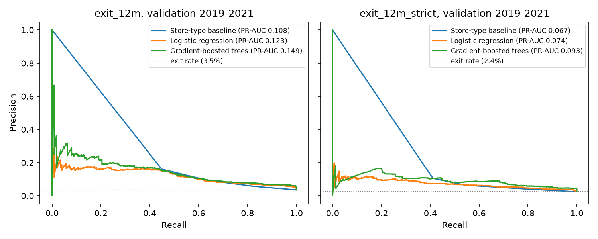

# D3 model results (validation 2019-2021)

Generated by `src/model/01_evaluate.py`; do not edit by hand. All models are fit on train cohorts 2012-2018 and scored on validation cohorts 2019-2021, the same rows for every model. Tuning used rolling folds inside 2012-2018 (fit 2012..k-1, score k, k = 2015-2018). The reserved test file is not read. Intervals: 1000 bootstrap resamples of stores (record_id).

## exit_12m

| Model | Fold PR-AUC (2015-18) | Validation PR-AUC (95% CI) | Diff vs baseline (95% CI) | ROC-AUC | Brier | Top-50/yr precision | Top-50/yr recall | Meck top-10/yr precision | Meck top-10/yr recall |
|---|---|---|---|---|---|---|---|---|---|
| Store-type baseline | 0.110 | 0.108 (0.088-0.130) |  | 0.752 | 0.0324 | 14.7% (22) | 9.8% | 20.0% (6) | 26.1% |
| Logistic regression | 0.147 | 0.123 (0.100-0.157) | 0.004 to 0.039 | 0.801 | 0.0324 | 17.3% (26) | 11.6% | 13.3% (4) | 17.4% |
| Gradient-boosted trees | 0.155 | 0.149 (0.118-0.194) | 0.022 to 0.076 | 0.818 | 0.0321 | 25.3% (38) | 16.9% | 26.7% (8) | 34.8% |

Exits caught in the top 50 that left no other SNAP grocery within 1 mile: Store-type baseline 1 of 44; Logistic regression 3 of 44; Gradient-boosted trees 8 of 44

## exit_12m_strict

| Model | Fold PR-AUC (2015-18) | Validation PR-AUC (95% CI) | Diff vs baseline (95% CI) | ROC-AUC | Brier | Top-50/yr precision | Top-50/yr recall | Meck top-10/yr precision | Meck top-10/yr recall |
|---|---|---|---|---|---|---|---|---|---|
| Store-type baseline | 0.044 | 0.067 (0.051-0.087) |  | 0.733 | 0.0230 | 8.7% (13) | 8.6% | 10.0% (3) | 15.0% |
| Logistic regression | 0.066 | 0.074 (0.056-0.104) | -0.005 to 0.026 | 0.778 | 0.0230 | 11.3% (17) | 11.3% | 6.7% (2) | 10.0% |
| Gradient-boosted trees | 0.059 | 0.093 (0.073-0.125) | 0.015 to 0.046 | 0.832 | 0.0229 | 14.0% (21) | 13.9% | 10.0% (3) | 15.0% |

Exits caught in the top 50 that left no other SNAP grocery within 1 mile: Store-type baseline 3 of 20; Logistic regression 0 of 20; Gradient-boosted trees 1 of 20

## Gradient-boosted trees minus logistic regression (validation PR-AUC)

- exit_12m: 95% CI 0.008 to 0.054; trees ahead in 100% of resamples
- exit_12m_strict: 95% CI 0.004 to 0.036; trees ahead in 99% of resamples

## Tuning (best setting per model and label)

- exit_12m, Logistic regression: {'C': 3.0}, mean fold PR-AUC 0.147 (range over grid 0.142-0.147)
- exit_12m, Gradient-boosted trees: {'lr': 0.1, 'leaves': 2, 'min_leaf': 100, 'l2': 0.0}, mean fold PR-AUC 0.155 (range over grid 0.116-0.155)
- exit_12m_strict, Logistic regression: {'C': 0.3}, mean fold PR-AUC 0.066 (range over grid 0.052-0.066)
- exit_12m_strict, Gradient-boosted trees: {'lr': 0.03, 'leaves': 2, 'min_leaf': 200, 'l2': 1.0}, mean fold PR-AUC 0.059 (range over grid 0.033-0.059)

